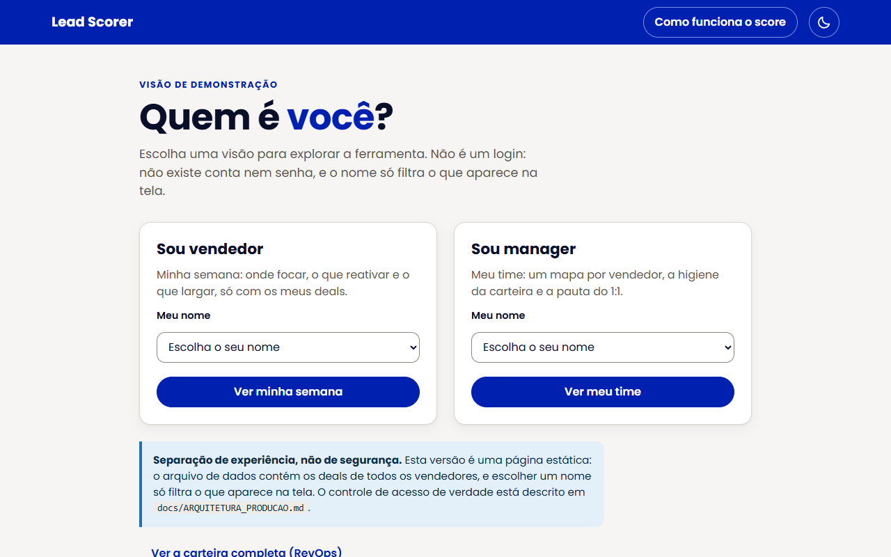
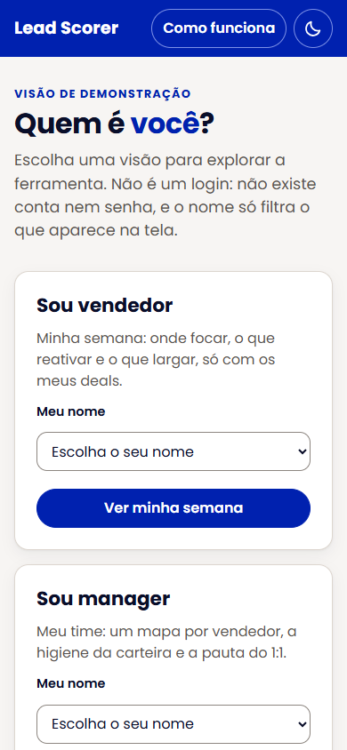
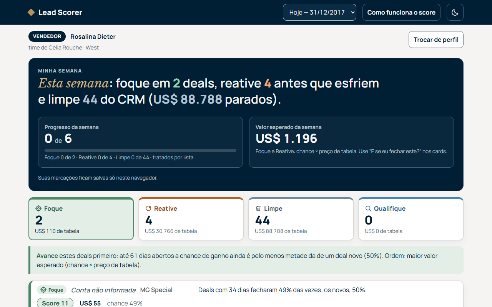
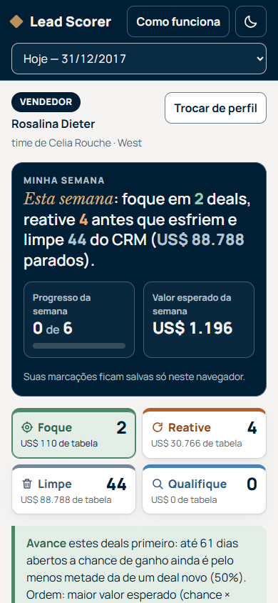
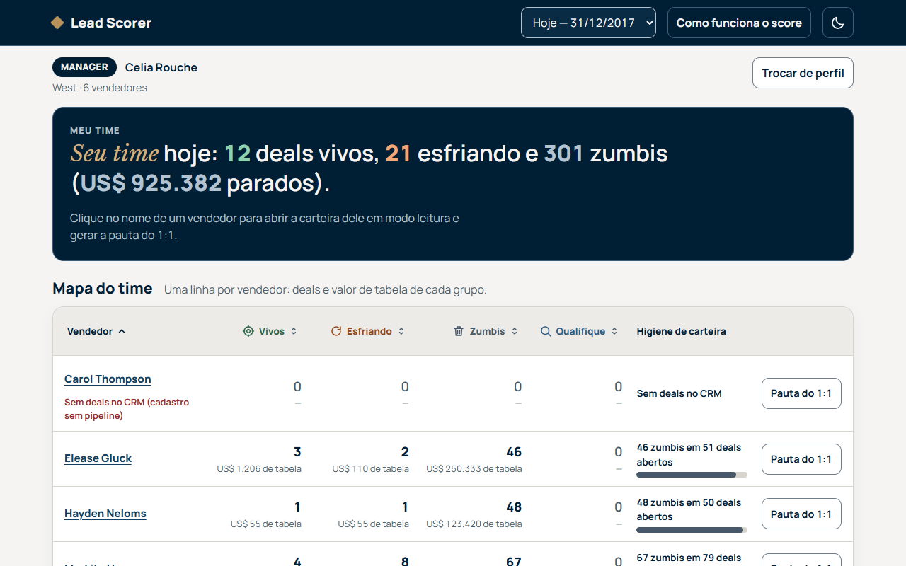
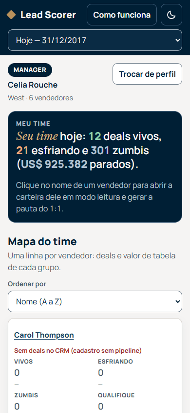
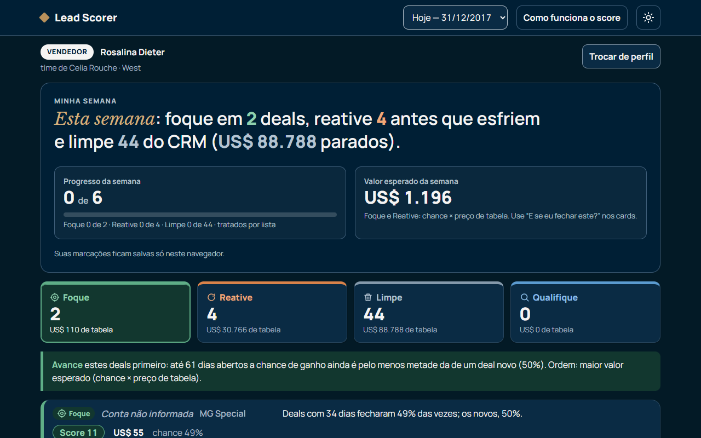

# Análise Officers — Lead Scorer: priorização de pipeline com frescor do deal

> Projeto pessoal de demonstração com dados públicos e fictícios (dataset CRM Sales Predictive Analytics, Kaggle, CC0). Não é um produto, serviço ou canal do Banco BS2 e não usa dados do banco.

> Esta versão pública reorganiza a documentação do experimento original; métodos, números, decisões e erros registrados são os mesmos.

Este repositório é um experimento pessoal para testar a aplicabilidade do Claude Code num problema real de ponta a ponta: um motor de score validado, uma ferramenta funcional e governança do processo. O problema de negócio é um cenário hipotético, em que uma Head de RevOps pede uma ferramenta para os officers (os vendedores, neste cenário) saberem onde focar na segunda-feira.

---

## Resumo executivo

Neste experimento com Claude Code, num cenário hipotético de RevOps, o que separa os deals do CRM é o frescor (há quanto tempo estão abertos), não o produto, o setor, a região ou o porte (todos ficam entre 60% e 65% de vitória), e a ferramenta usa isso para dizer a cada vendedor onde focar, o que reativar e o que largar. Em quatro datas passadas, os 20% de deals no topo do score concentraram em média 62,5% da receita ganha depois, contra 48,1% ordenando só pelo valor, 29,7% pelos mais recentes e 20,0% num sorteio, e o critério fixado antes do teste passou, mas a curva atual foi trocada depois do backtest, quando usei a ferramenta como vendedor e vi que a primeira versão dava a mesma chance de 0 a 95 dias. Hoje, 1.463 dos 1.589 deals em Engaging estão na lista Limpe (chance abaixo de 2% ou mais velhos que o maior ciclo já fechado), cerca de US$ 3,6 mi de valor de tabela provavelmente inflado, e só 60 estão no Foque. O ganho vem sobretudo de tirar esses deals parados do topo: entre os deals ainda vivos o score só empata com a ordenação por valor, dentro do Foque ele ordena pouco, e os dados são sintéticos. Recomendo um sprint de limpeza da lista Limpe, confirmando cada deal com o cliente antes de encerrar, e uma rotina de segunda-feira com as listas Foque e Reative.

---

## Experimente

Uma página estática, sem servidor, com duas visões. O **vendedor** abre "Minha semana" na segunda de manhã: escolhe o próprio nome e vê só os seus deals em quatro listas (Foque, Reative, Limpe e Qualifique), cada deal com uma explicação de 2 a 4 frases, ações salvas no navegador ("contatei", "agendei", "encerrar no CRM") e um simulador "e se eu fechar este?". O **manager** abre "Meu time": um mapa por vendedor (vivos, esfriando e zumbis, com o valor de cada grupo), a higiene da carteira e a pauta do 1:1, sem taxa de vitória nem ranking de vendedores. Há também um "modo teste", que mostra o que o score teria recomendado numa data passada e o que de fato aconteceu. Por trás, um motor em Python (pandas, funções puras, pytest) gera os dados da página. Documentos: [escopo](docs/SCOPE.md), [qualidade dos dados](docs/DATA_QUALITY.md), [score e validação](docs/SCORING.md), [model card](docs/MODEL_CARD.md) e [decisões](docs/DECISIONS.md).

1. **Abrir a ferramenta sem instalar nada.** Duplo-clique em [`solution/app/index.html`](solution/app/index.html) (funciona em `file://`, sem servidor e sem internet).
2. **Página publicada (GitHub Pages):** https://rafael-pereira-silva.github.io/analise-officers/solution/app/. Links diretos, um por visão:
   - [Entrar como vendedor (ex.: Rosalina Dieter)](https://rafael-pereira-silva.github.io/analise-officers/solution/app/#perfil=vendedor&nome=Rosalina+Dieter)
   - [Entrar como manager (ex.: Celia Rouche)](https://rafael-pereira-silva.github.io/analise-officers/solution/app/#perfil=manager&nome=Celia+Rouche)
   - [Pauta do 1:1 da Rosalina Dieter, aberta pela Celia Rouche](https://rafael-pereira-silva.github.io/analise-officers/solution/app/#perfil=manager&nome=Celia+Rouche&ver=Rosalina+Dieter&pauta=1)
   - [Visão completa (RevOps), com todos os filtros](https://rafael-pereira-silva.github.io/analise-officers/solution/app/#perfil=revops)

**Atenção: nesta versão a separação entre vendedor e manager é de experiência, não de segurança.** O `data.js` contém os deals de todos os vendedores; escolher um nome só filtra a tela. A separação real (login e acesso por linha) está em [`docs/ARQUITETURA_PRODUCAO.md`](docs/ARQUITETURA_PRODUCAO.md).

---

## Como rodar

1. **Regenerar tudo a partir dos CSVs** (Python 3.11; testado com pandas 3.1, numpy 2.4, scipy 1.17 e pytest 9.1):

```
cd solution
pip install -r requirements.txt
python -m pytest
python -m scorer.build --reference-date 2017-12-31
```

2. **Verificação opcional da interface** (abre a página num navegador, confere contagens, filtros, layout em computador e celular, contraste e console):

```
pip install -r requirements-dev.txt
python tools/check_app.py --prefix final
python tools/check_views.py
```

O segundo script testa as visões por perfil: vendedor isolado, pauta do manager, totais contra o `data.js`, alternância de tema e acessibilidade com o axe-core nos dois temas. O Lighthouse não foi executado (a máquina de desenvolvimento não tinha Node).

O build é determinístico: rodar duas vezes gera os mesmos bytes. A data de referência ("hoje", 31/12/2017) é um parâmetro, não está fixa no código.

---

## Abordagem

1. **Do problema da Head de RevOps ao que medir.** As duas dores são tempo jogado em deal que não fecha e deal bom esfriando sem alerta. Isso não pede "qual deal tem mais chance", pede "onde ponho minha próxima hora". Por isso a métrica primária é a receita ganha capturada pelos 20% do topo, e a AUC é reportada, mas não decide. Essa regra foi escrita no [escopo](docs/SCOPE.md) antes do código de avaliação.
2. **Os dados derrubaram a ideia óbvia.** Um score por atributos dá perto de 63% para todo deal. O que separa é o ciclo: nenhum deal foi ganho depois de 138 dias, e 81% dos Engaging já passaram disso. Antes de usar qualquer coisa, limpei o que quebra o join e o que vaza: "GTXPro" contra "GTX Pro" (1.480 deals sumiriam) e os 1.425 deals sem conta, todos abertos, que funcionariam como detector de zumbi ([qualidade dos dados](docs/DATA_QUALITY.md)).
3. **O score.** Chance de ganho em 90 dias olhando só a idade do deal, vezes o preço de tabela, numa escala de 0 a 100. A curva cai com a idade desde o primeiro dia (faixas de idade com regressão isotônica) e é treinada só com as fotos do mesmo ponto do trimestre que a data do modelo. Os limites das listas saem da curva (Foque até a chance cair à metade da de um deal novo; Limpe quando ela fica abaixo de 2% ou o deal passa do maior ciclo já ganho), não de um "se idade > 138". O vendedor não entra, e nenhum atributo entrou depois do teste ([score e validação](docs/SCORING.md)).
4. **Validação sempre no tempo.** Quatro cortes passados (30/06, 31/07, 31/08 e 30/09/2017), cada um com um modelo que só vê o que o CRM sabia naquele dia, contra três baselines: valor, recência e sorteio. O critério para "vencer" foi fixado antes do primeiro número e foi mantido na correção da curva. Um teste troca tudo o que acontece depois do corte por valores aleatórios e exige que o modelo e os scores não mudem.
5. **Interface de decisão.** Tela de entrada "Quem é você?" (vendedor ou manager), frase de ação no topo ("foque em N, reative M, limpe K"), uma lista por ação, explicação por deal e o modo teste, para a Head de RevOps (hipotética) ver o score contra a história antes de confiar nele. A primeira versão tinha um visual sóbrio, em marinho, off-white e um único dourado de ação; o tema atual o substituiu e é inspirado na paleta do Banco BS2 (só inspiração: o projeto não tem relação com o banco, ver o aviso no topo). Os tokens, o contraste e as decisões estão em [`docs/DESIGN.md`](docs/DESIGN.md) e em [`process-log/09_tema-bs2.md`](process-log/09_tema-bs2.md).

---

## Resultados

Seis achados, todos gerados por script a partir do `backtest_metrics.json` (a curva v1 é a versão antes da correção; a v2 é a atual):

<!-- AUTO:readme-achados -->
- **Critério pré-registrado: PASSOU para a curva v2 e PASSOU para a v1.** O score v2 vence valor, recência e o sorteio nos 4 cortes. A v2 é uma mudança pós-backtest, pedida por mim depois de usar a ferramenta como vendedor.
- **Receita média no top 20%:** score v2 62,5%, score v1 61,1%, valor 48,1%, recência 29,7%, aleatório 20,0%.
- **A curva v1 era plana de 0 a 95 dias; a v2 cai desde o primeiro dia.** Hoje, a chance de um deal novo é 49,5%, com 30 dias 49,0%, com 60 dias 27,0% e com 90 dias 6,6%. O Foque de hoje passou de 126 para 60 deals.
- **Dentro do Foque (deals de até 90 dias) a ordem melhorou pouco:** receita no top 20% de 52,5% (v1 49,7%, valor 49,1%) e AUC de 0,52, perto de um sorteio. O ganho está no corte de fim de trimestre.
- **A recência ganha em AUC** em 3 dos 4 cortes (30/06, 31/08 e 30/09); a maior folga é em 30/09/2017, com 0,83 contra 0,72 do score v2.
- **Entre os deals já resolvidos o score empata com o valor:** receita média no top 20% de 48,9% contra 49,0%, e a maior diferença em um corte é de 1,0 pp. A vantagem do backtest completo vem de tirar do topo os deals parados.
<!-- /AUTO:readme-achados -->

**A correção da curva (depois do backtest, a pedido meu).** Usei a página publicada como vendedor e o top da Rosalina Dieter era um GTK 500 com 95 dias e score 100. A curva v1 era plana de 0 a 95 dias; o briefing mostrava 50%, 34%, 7% e 0% por faixa de idade. Dois motivos: o treino misturava fotos de fases diferentes do trimestre, com padrões opostos, e o desenho "platô + queda" impõe chance constante antes do joelho. A v2 treina cada data só com fotos do mesmo mês do trimestre e é monotônica desde o dia 0. Antes e depois:

<!-- AUTO:scoring-correcao -->
- **Chance de hoje.** v1: 40% de 0 a 95 dias, igual para todos (o platô). v2: 50% para um deal novo e 49% com 30 dias, 27% com 60 dias, 7% com 90 dias.
- **Listas de hoje.** Foque: 126 → 60 deals. Reative: 172 → 66. Limpe: 1.291 → 1.463 (US$ 3.198.664 → US$ 3.591.439 de tabela).
- **Backtest principal (receita no top 20%, média dos cortes).** v1: 61,1%; v2: 62,5%. AUC: 0,64 → 0,66.
- **Ordem dentro do Foque (deals de até 90 dias).** Receita no top 20%: v1 49,7%, v2 52,5%, valor 49,1%; AUC: v1 0,51, v2 0,52, valor 0,50.
<!-- /AUTO:scoring-correcao -->

A melhora está concentrada no corte de fim de trimestre (30/09). A ordem dentro do Foque (deals de até 90 dias, média dos 4 cortes) é só um pouco melhor que a do preço:

<!-- AUTO:mc-ordem-foque -->
| Método (deals de até 90 dias, média dos cortes) | AUC | Receita no top 20% |
| :--- | ---: | ---: |
| Score v2 (curva por faixas) | 0,52 | 52,5% |
| Score v1 (platô) | 0,51 | 49,7% |
| Ordenar por valor | 0,50 | 49,1% |
| Mais recentes primeiro | 0,56 | 23,5% |
| Aleatório (referência) | 0,50 | 20,1% |
<!-- /AUTO:mc-ordem-foque -->

**Backtest corte a corte** (a tabela completa, com ganhos capturados, bootstrap e calibração, está no [SCORING](docs/SCORING.md)):

<!-- AUTO:readme-backtest -->
| Corte | Receita no top 20%: score v2 | score v1 | valor | recência | aleatório | AUC do score v2 | AUC da recência |
| :--- | ---: | ---: | ---: | ---: | ---: | ---: | ---: |
| **Média dos 4 cortes** | 62,5% | 61,1% | 48,1% | 29,7% | 20,0% | 0,66 | 0,70 |
| 30/06/2017 | 61,0% | 61,3% | 48,6% | 27,7% | 20,0% | 0,66 | 0,73 |
| 31/07/2017 | 57,4% | 57,9% | 48,7% | 12,8% | 20,1% | 0,63 | 0,58 |
| 31/08/2017 | 59,9% | 60,7% | 48,2% | 31,6% | 19,8% | 0,63 | 0,66 |
| 30/09/2017 | 71,7% | 64,8% | 47,1% | 46,8% | 20,3% | 0,72 | 0,83 |

Receita capturada pelos 20% de deals no topo da ordenação, como fração da receita que foi de fato ganha depois. Aleatório = média de 200 sorteios. Cada corte usa só o que o CRM sabia naquele dia.
<!-- /AUTO:readme-backtest -->

**As quatro listas de hoje (31/12/2017):**

<!-- AUTO:readme-hoje -->
| Lista | Idade do deal | Ação | Deals | Valor de tabela |
| :--- | :--- | :--- | ---: | ---: |
| Foque | até 61 dias | avançar | 60 | US$ 123.253 |
| Reative | 62 a 95 dias | retomar o contato | 66 | US$ 177.537 |
| Limpe | mais de 95 dias | confirmar e encerrar ou atualizar | 1.463 | US$ 3.591.439 |
| Qualifique | Prospecting (sem data) | qualificar | 500 | US$ 1.073.986 |
<!-- /AUTO:readme-hoje -->

O Limpe tem zero ganhos nos quatro cortes do backtest, por construção do dataset. A lista Reative teve de 0% a 5% de ganhos nos cortes: promete pouco e entrega pouco.

**A interface** (computador e celular; dados reais, tirados por `tools/check_app.py`):





As duas visões depois de escolher o perfil (vendedor Rosalina Dieter e manager Celia Rouche), em computador e celular, e o tema escuro:











Atributos testados e descartados (um por vez, com a regra fixada antes): produto, região, setor e porte. A região parecia ajudar dentro da amostra de treino e piorou fora dela em três dos quatro cortes, que é o motivo de a validação ser temporal.

---

## Recomendações

Para a Head de RevOps, em ordem de prioridade:

1. **Sprint de limpeza da lista Limpe.** São 1.463 deals e cerca de US$ 3,6 mi de valor de tabela (1.291 deles passam do maior ciclo já fechado). Limpe quer dizer confirmar com o cliente e então encerrar ou atualizar, não descartar: o deal parado pode ser CRM desatualizado. Feito isso, o pipeline passa a mostrar o que é vivo.
2. **Rotina de segunda-feira com Foque e Reative.** Cada vendedor abre o próprio brief, trabalha o Foque e dá um contato de retomada no Reative. Hoje é fim de trimestre, e o Foque ficou curto (deals de até 61 dias): o que já passou disso cai para Reative ou Limpe.
3. **Higiene do CRM.** Preencher a conta (1.425 deals não têm), registrar a data em que o deal entrou em Prospecting (os 500 não têm, e por isso não podem ser pontuados) e guardar o histórico de estágios. Sem isso, a lista Qualifique não tem prova e o score só enxerga "dias desde o engajamento".
4. **Não usar win rate por vendedor.** A diferença entre vendedores é compatível com ruído (qui-quadrado p=0,26). Cobrar ou premiar com base nela pune pessoas por acaso.
5. **Recalibrar com dados reais.** Este dataset é sintético. Rodar o mesmo backtest, com o mesmo critério fixado antes, num CRM real, a cada trimestre (regras de recalibração no [model card](docs/MODEL_CARD.md)).

---

## Limitações

- **Dataset sintético.** O teto de 138 dias, a regra de fechar no trimestre do engajamento ou no seguinte e os fechamentos rápidos no primeiro mês do trimestre são padrões do gerador. Estão documentados e não são explorados, mas o Limpe herda o teto de 138 dias; em CRM real um deal mais velho pode ser ganho.
- **A vantagem vem dos zumbis.** Entre os deals já resolvidos o score só empata com o valor. A ferramenta ajuda a limpar a fila e a priorizar por valor; não prova que escolha bem entre os deals vivos.
- **A recência ganha em AUC** em três dos quatro cortes. O score ganha onde importa para a pergunta da Head de RevOps (receita), não em quem vai ganhar.
- **A curva v2 foi trocada depois do backtest.** O PASSOU do critério para a v2 não é um teste às cegas: a v2 foi desenhada sabendo o que o backtest da v1 mostrou. Dentro do Foque a ordem melhora pouco (AUC perto de um sorteio) e a melhora está concentrada no corte de 30/09.
- **Três dos quatro cortes têm uma foto de treino só**, porque agora só vale a fase do trimestre do corte. A regra "fotos a partir de 31/03" foi escolhida depois de o planejador ver o protótipo. Com 28/02 o critério também passaria; a diferença está na [seção 7 do SCORING](docs/SCORING.md). O teste de atributos não foi repetido sobre a v2.
- **Censura:** deals abertos em 31/12/2017 contam como "não ganho". Prospecting não tem score nem backtest. Horizonte de 90 dias e passo da grade do joelho não tiveram sensibilidade medida.
- **chat-exports não incluídos.** O export integral da conversa de orquestração não está nesta versão pública ([`process-log/chat-exports/`](process-log/chat-exports/LEIA-ME.md)); o registro do processo está nos logs por bloco, no DECISIONS e no histórico do git. A fase 0, feita no app do Claude, está registrada em narrativa, sem export.
- **Git:** a máquina não tinha git nem gh. O repositório foi clonado e commitado com dulwich (biblioteca Python), por um helper fora da pasta; o autor dos commits é o Rafael, com o trailer `Co-Authored-By: Claude`.
- **Interrupção por limite de API.** Os executores pararam entre 16:28 e 19:01 de 25/10/2026, no meio do bloco 3. O critério pré-registrado e o rascunho do SCORING já estavam gravados e nenhum resultado de backtest tinha sido visto antes da retomada ([log do bloco 3](process-log/03_bloco-3.md)).
- **Separação de experiência, não de segurança.** A visão do vendedor e a do manager só filtram a tela: o `data.js` público contém os deals de todos os vendedores, e quem baixa o arquivo vê tudo. Isso é aceitável com dados sintéticos e públicos, mas não com dados reais de clientes. A arquitetura com login e acesso por linha (Supabase, Auth com SSO e Row-Level Security) está desenhada em [`docs/ARQUITETURA_PRODUCAO.md`](docs/ARQUITETURA_PRODUCAO.md), com o SQL marcado "não executado — validar" (a máquina não tinha Postgres nem Docker) e uma estimativa de esforço de migração.
- **As marcações do vendedor ficam só no navegador.** "Contatei", "agendei" e "encerrar no CRM" vão para o `localStorage`: não chegam ao CRM, não são vistas pelo manager e somem se a pessoa limpar os dados do navegador. A tela avisa isso. O manager lê a carteira, não edita.
- **Higiene de carteira não é desempenho.** O mapa do time conta deals por lista (vivos, esfriando e zumbis) e é ordenável, mas não traz taxa de vitória nem ranking de vendedores (decisão 4 do CLAUDE.md).
- **Qualidade da interface medida em parte.** O axe-core rodou nos dois temas e em duas larguras, sem violações graves; o Lighthouse não rodou (sem Node), e a skill de design e o arquivo do Figma não estavam disponíveis, então o Figma serviu só como inspiração. O desenho da pauta do 1:1 e do simulador não foi testado com vendedores de verdade.

---

## Como usei IA

**Como eu trabalhei, em uma frase:** primeiro explorei os dados em conversa com o Claude até entender o problema. Depois transformei o que aprendi em regras escritas (o "kit": [`CLAUDE.md`](CLAUDE.md), [`PROMPTS.md`](PROMPTS.md), [`GUIA.md`](GUIA.md) e [`PROMPT_AUTONOMO.md`](PROMPT_AUTONOMO.md)). Por fim, deleguei a execução a uma equipe de agentes Claude, sob controles que eu defini. Não colei o problema numa IA para esperar o resultado. Montei e governei um processo de desenvolvimento com IA, e cada decisão dele é auditável. O mapa completo das evidências está em [`process-log/README.md`](process-log/README.md).

### Ferramentas usadas

| Ferramenta | Para que usou |
|------------|--------------|
| Claude (app), Sonnet 5.5 e depois Opus 5.5 | Fase 0, em conversa comigo: ler o material de partida, comparar 4 problemas em consideração, explorar os dados, derrubar a hipótese "score por atributos" e validar o frescor. Depois, redigir comigo o kit de regras e prompts por bloco ([`00_fase0_exploracao.md`](process-log/00_fase0_exploracao.md)) |
| Claude Code com Opus 5.5 (orquestrador) | Executar o meu prompt de operação ([`PROMPT_AUTONOMO.md`](PROMPT_AUTONOMO.md)): preparar o ambiente, disparar e conferir os executores, consolidar os logs e commitar um bloco por vez |
| Subagente Claude Opus 5.5 (planejador, somente leitura) | Transformar o kit num plano de execução com especificação por etapa e protótipos descartáveis ([`plano_execucao_opus.md`](process-log/plano_execucao_opus.md)) |
| Subagentes Claude Sonnet e Haiku (executores) | Fazer o volume: código, testes, interface e documentos. Haiku no trabalho mecânico, Sonnet no que exige julgamento local. Cada log declara o executor |
| Subagente de contexto limpo (revisor, bloco 6) | Fazer o papel de revisor independente: duas revisões, sem acesso ao processo, que avaliam a entrega contra critérios de qualidade (funciona, scoring, usabilidade, decisão, código, documentação e processo) e apontam o que pareceria entrega de IA sem supervisão ([`06_revisao-independente.md`](process-log/06_revisao-independente.md)) |
| Playwright + Edge, axe-core, pytest, git/gh | Ferramentas que não são de IA e que eu usei para não acreditar na palavra da IA: o Playwright abre a página de verdade (local e publicada), o axe-core audita a acessibilidade, o pytest prova as regras e o git registra um commit por etapa |

### Workflow

**Quem fez o quê.** A IA escreveu quase todo o código e o texto. O desenho, as regras e os pontos de decisão foram meus.

| O que eu decidi ou defini | O que deleguei à IA | O controle que eu exigi para confiar no resultado |
|---|---|---|
| A escolha do problema para o experimento e a leitura da dor como "alocação de tempo", não "qual deal tem mais chance" | Escopo detalhado e respostas às 4 perguntas abertas | Cada resposta com alternativa descartada e número ([`SCOPE.md`](docs/SCOPE.md)) |
| A tese "frescor > atributos", depois que os dados derrubaram o meu plano inicial | Curva de chance por idade, score e explicações | Backtest temporal em 4 cortes contra 3 baselines, com critério e ajuste único fixados antes |
| Tirar o vendedor do score (diferença compatível com ruído) | Implementação do score | Teste de permutação: trocar os vendedores de lugar não muda nenhum score |
| "Nenhum número in-sample é resultado" e "nenhum número digitado à mão" | Limpeza, métricas e documentos | Teste que confere cada número da prosa contra os arquivos gerados; teste de mutação do futuro contra vazamento |
| Não usar Streamlit; página estática que abre com duplo-clique | Interface e build | Playwright em `file://` com dezenas de checagens, inclusive contagens contra o SCORING, mais uma bateria própria para as visões por perfil e o axe-core |
| Não publicar nada em meu nome sem mim | Commits locais e texto de publicação | O push e o GitHub Pages ficaram reservados para mim |
| Revisão independente e "não maquie resultado" | Correções apontadas pelo revisor | Modelo, parâmetros e métrica congelados no bloco 6: crítica de modelagem vira limitação documentada, não ajuste pós-hoc. Depois, ao usar a ferramenta como vendedor, pedi a troca da curva, que ficou declarada como mudança pós-backtest, com a versão antiga ao lado |

Passo a passo:

0. **Fase 0 (eu + Claude app) e bloco 0 (setup).** Explorei os dados em conversa, achei o join quebrado ("GTXPro") e a métrica inflada, e pivotei do score por atributos para o frescor. Com isso redigi o kit: 7 decisões fechadas, um prompt por bloco com checkpoints, o guia de armadilhas e o prompt de operação. No Claude Code, o orquestrador montou o ambiente, e um executor Haiku reproduziu os números da fase 0 contra o briefing antes de qualquer código novo.
1. **Bloco 1, escopo.** Um executor Sonnet respondeu às 4 perguntas que eu tinha deixado em aberto. Cada resposta traz alternativa descartada e evidência. O executor também achou um erro no meu briefing (o produto com mais deals) e contestou com dados uma justificativa do plano.
2. **Bloco 2, dados.** Limpeza com três investigações, cada uma com critério escrito antes do resultado. Montamos a infraestrutura "todo número vem de script": blocos de documento regenerados e um teste que confere cada número da prosa.
3. **Bloco 3, score e validação.** A checagem de vazamento foi escrita antes do código, como exigi. O critério de sucesso foi registrado antes do primeiro número de desempenho. O critério passou na primeira rodada, e o ajuste único reservado não foi usado (a troca de curva do item 7 é outra coisa, feita depois).
4. **Bloco 4, ferramenta.** Para acelerar sem perder qualidade, a interface foi construída em paralelo ao motor, a partir de um contrato de dados escrito antes. Depois a página foi verificada com Playwright, e uma passada "vendedor na segunda de manhã" corrigiu 3 atritos com screenshots de antes e depois.
5. **Bloco 5, documentação.** README e model card, com todos os números vindos de blocos regenerados e conferidos por teste.
6. **Bloco 6, revisão independente.** Dois revisores de contexto limpo avaliaram a entrega contra critérios de qualidade (funciona, scoring, usabilidade, decisão, código, documentação e processo). As críticas de interface e documentação foram corrigidas. As de modelagem viraram texto com número, porque eu tinha congelado o modelo para evitar ajuste pós-hoc ([relatórios e triagem](process-log/06_revisao-independente.md)).
7. **Revisão minha e correção da curva.** Depois do bloco 6, revisei a entrega e usei a página publicada como vendedor: a chance era constante de 0 a 95 dias e o top da Rosalina Dieter era um GTK 500 com 95 dias. Pedi a correção de ponta a ponta (curva, limiares, métrica de ordem dentro do Foque, frase do card, interface e documentos), com a curva antiga mantida para comparação e a mudança declarada como pós-backtest ([registro](process-log/07_correcao-curva.md)).
8. **Visões por perfil, arquitetura de produção e design.** Escrevi a especificação ([`PROMPT_VISOES_E_DESIGN.md`](PROMPT_VISOES_E_DESIGN.md)) com três peças:
   - a entrada por perfil: "Minha semana" para o vendedor, "Meu time" para o manager, com pauta do 1:1 e higiene de carteira (sem ranking de vendedor), e uma visão completa para RevOps;
   - a segregação real de dados documentada como arquitetura de produção ([`ARQUITETURA_PRODUCAO.md`](docs/ARQUITETURA_PRODUCAO.md));
   - uma direção visual (a identidade da primeira versão, em marinho e dourado, foi depois substituída pelo tema atual; [`DESIGN.md`](docs/DESIGN.md) e [`09_tema-bs2.md`](process-log/09_tema-bs2.md)).
   A interface passou por três rodadas de screenshots com crítica e correção, e por auditoria de acessibilidade com axe-core ([registro](process-log/08_visoes-e-design.md)).

**Onde eu intervim durante a execução** (registrado nos logs por bloco e no [`DECISIONS.md`](docs/DECISIONS.md); o export integral da conversa não está nesta versão pública, ver [`chat-exports/`](process-log/chat-exports/LEIA-ME.md)):
- **Paralelizar sem perder qualidade.** Pedi para acelerar com trabalho paralelo, sem perder qualidade. O orquestrador redesenhou o fluxo para até 3 executores ao mesmo tempo, com posse exclusiva de arquivos e um commit por bloco.
- **Retomar sem refazer.** A cota de uso acabou no meio do bloco 3. Mandei retomar os executores de onde pararam, não recomeçar.
- **Gestão de custo.** Pedi para refinar as instruções e usar cada modelo no esforço exato. A partir daí, cada etapa teve modelo e nível de esforço escolhidos por complexidade, com executores retomados em vez de recriados.
- **Revisão final.** Revisei a entrega, alinhei a narrativa à governança de IA e reforcei as evidências ([`07_revisao-do-rafael.md`](process-log/07_revisao-do-rafael.md)).
- **Correção da curva.** Usei a ferramenta publicada como vendedor, vi o problema e pedi a correção ([`07_correcao-curva.md`](process-log/07_correcao-curva.md)).

### Onde a IA errou e como corrigi

Só episódios registrados em `process-log/` e em `docs/DECISIONS.md`. Na execução delegada, quem pegou os erros foram os controles que eu tinha exigido: verificação de números, testes de vazamento, critério pré-registrado e conferência visual.

**Na fase 0, com o Rafael:**

- **Métrica otimista (fase 0, com Rafael).** O primeiro cálculo de poder preditivo por categoria usou target encoding dentro da própria amostra e saiu inflado. Desconfiei do número, marquei como inflado e decidi exigir backtest temporal para qualquer número de desempenho.
- **Win rate de 82% no 1º trimestre tratado como possível insight (fase 0, com Rafael).** Rebaixei a achado suspeito de artefato de recorte. O bloco 2 investigou e confirmou: os fechamentos do trimestre são só de março.
- **Plano inicial com score por atributos (fase 0, com Rafael).** O plano assumia win rate por produto ou setor. Os dados mostraram todos entre 60% e 65%, e eu pivotei para o frescor.

**Na execução delegada (os onze primeiros foram pegos pelos controles; o último, não):**

- **Erro do briefing sobre o MG Special (execução delegada).** O briefing dizia que o produto tinha o maior volume de deals, e o primeiro rascunho do escopo repetiu a frase. A regra "todo número sai dos dados" fez o executor conferir: o GTX Basic tem mais deals, e o MG Special é o segundo. O escopo e o `facts.json` foram corrigidos. O briefing, insumo da fase 0, foi mantido, com a divergência registrada.
- **Justificativa do plano para a pergunta 3 refutada (execução delegada).** O plano dizia que a chance de ganho é estável enquanto o deal é jovem, mas as fotos do briefing mostram a chance caindo desde cedo. A decisão de ordenar o Foque por valor esperado foi mantida, e a justificativa foi trocada.
- **Generalização indevida (execução delegada).** Uma versão do escopo dizia que "fora da amostra os atributos têm AUC ≈ 0,50", mas isso vale só para as variáveis numéricas. O texto passou a dizer exatamente isso.
- **Protótipo não monotônico (execução delegada).** O protótipo do planejador gerou uma curva que sobe com a idade até 90 dias, o que não faz sentido para uma lista de prioridades. A inclinação passou a ser limitada a zero ou negativa antes do backtest. A regra de começar as fotos em 31/03 foi decidida depois de ver esse protótipo, e isso está declarado como limitação.
- **Tolerância pós-hoc na investigação 2a (execução delegada).** A tolerância de 7 dias foi escolhida depois de ver as folgas. O documento declara que a condição vale no limite e não é um teste independente.
- **`beats` com ponto flutuante (execução delegada).** Em ponto flutuante, 0,61 menos 0,60 dá 0,010000000000000009, e com isso um empate contaria como vitória no critério pré-registrado. Corrigido e coberto por teste.
- **Teste de vazamento que não provava nada (execução delegada).** Um teste passaria mesmo com a guarda quebrada. Foi trocado por um teste com o futuro mutado, e seis guardas foram estragadas de propósito para ver os testes falharem de verdade.
- **Previsão do plano falsa (execução delegada).** O plano previa que a chance sozinha nunca ordenaria melhor que a recência em AUC. Em 31/07 a AUC da chance sozinha é 0,64 e a da recência, 0,58. O SCORING registra isso como erro de previsão do plano.
- **Rascunho do SCORING com afirmações que não batiam (execução delegada).** O verificador de números acusou valores sem fonte. Uma conferência achou frases erradas, por exemplo "três fotos" onde eram duas. Tudo foi corrigido antes de fechar.
- **`pytest` que travou (execução delegada).** Uma execução passou de 10 minutos. O log registra que a causa não foi diagnosticada, em vez de inventar um motivo. Num caso parecido no bloco 4, a causa foi achada: um assert que tentava imprimir o arquivo de dados inteiro.
- **Contraste e telas vazias (execução delegada).** O script de contraste reprovou a cor da lista Reative. Além disso, a aba padrão deixava vazia a tela do vendedor com mais deals. As duas coisas foram corrigidas antes dos screenshots finais.
- **Curva em patamar que contradizia o briefing (execução delegada).** A IA ajustou uma curva em patamar e o Rafael detectou o problema usando a ferramenta publicada como vendedor (o top da Rosalina Dieter era um GTK 500 com 95 dias e score 100). Nenhum controle pegou: o backtest passou, o verificador de números conferia só os números, e o texto do SCORING ainda justificava o patamar com "o sinal troca entre os cortes". O briefing já mostrava 50%, 34%, 7% e 0% por idade, e a curva não foi confrontada com ele. A correção (curva por faixas, fotos da mesma fase do trimestre, limiares revistos, frase do card comparativa, resumos do modo teste seguindo os filtros) está em [`process-log/07_correcao-curva.md`](process-log/07_correcao-curva.md), com os números antes e depois.

### O que eu adicionei que a IA sozinha não faria

Trabalho com governança de IA, e foi com esse olhar que conduzi o experimento: tratei o meu próprio uso de IA como um sistema que precisa de regras, rastreabilidade e um humano responsável. O que adicionei vai de entender o problema antes de abrir a ferramenta a decidir o que automatizar e o que não automatizar.

- **Entendi o problema antes de construir.** Li a dor da Head de RevOps como alocação de tempo, não como previsão. Daí vieram as quatro listas de ação e a métrica "receita capturada no topo". Escolhi este problema porque o entregável é verificável e porque explicabilidade e validação são exatamente o meu campo.
- **Desconfiei dos números certos.** Desconfiei da métrica inflada da fase 0, do win rate de 82% que parecia insight e do teto de 138 dias que parecia regra de negócio. Nos três casos a IA apresentou o número com confiança, e nos três o contexto mostrou que era artefato. Isso virou regra do projeto: nenhum número in-sample é resultado.
- **Coloquei justiça antes de acurácia.** O vendedor ficou fora do score, porque a diferença entre vendedores é compatível com ruído e usá-la puniria pessoas por acaso. A regra virou um teste de permutação e uma linha do model card dizendo que a ferramenta não serve para avaliar vendedores.
- **Governei a IA como governo modelos.** Apliquei ao processo os mesmos controles que aplico a sistemas de IA:
  - separação de funções (quem planeja não executa, quem revisa não viu o processo);
  - critério de sucesso registrado antes do teste, com um único ajuste permitido;
  - trilha de auditoria (uma decisão por linha, com a alternativa descartada);
  - verificação automática de cada número publicado;
  - revisão independente com poder de crítica real.
- **Decidi o que não automatizar.** Automatizei o volume: código, testes, documentos, revisão. Reservei para mim a escolha do problema, a tese, a regra de justiça e a publicação em meu nome. E deixei escrito antes, no prompt de operação, que o modelo só teria um ajuste e que o resultado não seria maquiado. Essa regra funcionou quando os dois revisores criticaram o mesmo ponto (dentro do Foque, o score equivale ao preço): a IA não mexeu na curva depois de ver o backtest. Mas o ponto estava certo, e eu o vi com os meus olhos ao usar a ferramenta como vendedor. A correção foi pedida por mim depois do backtest, e por isso está declarada como mudança pós-backtest, com a curva antiga ao lado, o critério reportado para as duas e os números que não melhoraram à vista.
- **Exigi honestidade sobre os limites.** Pedi resultado sem maquiagem. Por isso a entrega diz onde o score perde (a recência ganha em AUC; entre deals vivos ele só empata com o valor) e por que a lista Limpe se chama "Limpe" e não "Descarte": um deal parado pode ser só CRM desatualizado.
- **Usei a ferramenta como o usuário dela, e achei o erro que os testes não pegaram.** Abri a página publicada como uma vendedora (Rosalina Dieter) e vi que o deal do topo era um GTK 500 com 95 dias, com a mesma chance de um deal novo. A curva passava em todos os testes, mas contradizia o que a própria exploração tinha mostrado. Pedi a correção de ponta a ponta, com a curva antiga ao lado para comparação e a mudança declarada como feita depois do backtest.
- **Tratei "vendedor não vê a carteira do outro" como requisito de controle, não de tela.** Numa página estática, esconder dados é só cosmético: o arquivo de dados vai inteiro para o navegador. Escolhi a versão estática (zero fricção para quem abre a ferramenta), declarei a limitação na própria interface e documentei a segregação real (login com SSO e Row-Level Security por papel) como arquitetura de produção.
- **Usei IA como alavanca, com custo sob controle.** Desenhei a operação: Opus planeja, Sonnet e Haiku executam em paralelo, e um revisor de contexto limpo faz o papel de revisor independente. Durante a execução, ajustei modelo e esforço para entregar dentro da cota, sem cortar validação nem process log.

---

## Reaproveitamento em outros contextos

O que sai deste dataset e o que fica nele.

**O que é reaproveitável fora deste dataset**

- **O método de validação no tempo:** cortes em datas passadas, um modelo que só vê o que o CRM sabia naquele dia, comparação com baselines simples (valor, recência e sorteio) e um critério de sucesso fixado antes do primeiro número.
- **O model card e a trilha de decisões:** [`MODEL_CARD.md`](docs/MODEL_CARD.md) e [`DECISIONS.md`](docs/DECISIONS.md), com uma linha por decisão e a alternativa descartada.
- **A regra de não pontuar pessoas:** o vendedor fica fora do score, e um teste de permutação prova isso.
- **As listas de ação com explicação por item**, em vez de um score solto que o vendedor não sabe usar.
- **As visões por perfil** (vendedor, manager e RevOps), cada uma com a pergunta que aquela pessoa faz na segunda-feira.
- **A arquitetura com segregação por papel**, em [`ARQUITETURA_PRODUCAO.md`](docs/ARQUITETURA_PRODUCAO.md) (desenho em documento, com o SQL marcado "não executado — validar").

**O que não é reaproveitável**

- **A curva e os números.** O dataset é sintético: o teto de 138 dias, a regra de fechar no trimestre do engajamento ou no seguinte e a forma da curva vêm do gerador. Os resultados acima não dizem nada sobre um CRM real.

**Um piloto em 2 passos**

1. **Diagnóstico com histórico real de CRM.** Rodar o mesmo backtest, com o critério fixado antes, sobre o histórico de um CRM real, e ver se o score bate os baselines (valor, recência e sorteio).
2. **Teste com um time e controle, só se o passo 1 bater os baselines.** Dar as listas a um time e manter outro como controle, e comparar a receita ganha e o tempo dedicado a deals que não fecham.

---

## Evidências

Tudo está neste repositório. O índice, que liga cada pergunta sobre o processo ao arquivo que a responde, é o [`process-log/README.md`](process-log/README.md).

- Screenshots da ferramenta com dados reais do dataset: [computador](process-log/screenshots/final_inicio_1280.png), [celular](process-log/screenshots/final_inicio_390.png), os pares antes/depois dos 3 atritos corrigidos e o par antes/depois da correção da curva (vendedora Rosalina Dieter, aba Foque: `antes-correcao-rosalina-*` e `depois-correcao-rosalina-*`) em [`process-log/screenshots/`](process-log/screenshots/).
- Registro da conversa: o export integral da conversa de orquestração não está nesta versão pública ([`chat-exports/`](process-log/chat-exports/LEIA-ME.md)). O processo está nos logs por bloco, no [DECISIONS](docs/DECISIONS.md) e no histórico do git. A fase 0, feita no app do Claude, está registrada em narrativa em [`00_fase0_exploracao.md`](process-log/00_fase0_exploracao.md).
- Git history: um commit por etapa (`bloco 0` a `bloco 7`, depois `correção: curva de chance…`, `visões vendedor/manager`, `arquitetura de produção (doc)` e `design: …`), autor Rafael Pereira, com o trailer `Co-Authored-By: Claude`.
- Screenshots das três rodadas de design ([`design-r1/`](process-log/screenshots/design-r1/), [`design-r2/`](process-log/screenshots/design-r2/) e [`design-r3/`](process-log/screenshots/design-r3/)) e as telas finais por perfil, como `final-vendedor-*`, `final-manager-*` e `final-escuro-*`.
- O kit que escrevi antes de delegar: [`CLAUDE.md`](CLAUDE.md) (7 decisões fechadas), [`PROMPTS.md`](PROMPTS.md) (um prompt por bloco com checkpoints), [`GUIA.md`](GUIA.md) (armadilhas) e [`PROMPT_AUTONOMO.md`](PROMPT_AUTONOMO.md) (regras de operação e de honestidade do process log). Depois da primeira entrega, escrevi também [`PROMPT_VISOES_E_DESIGN.md`](PROMPT_VISOES_E_DESIGN.md) (visões por perfil, arquitetura de produção e design).
- O plano do planejador ([`plano_execucao_opus.md`](process-log/plano_execucao_opus.md)), os logs por bloco (de [00](process-log/00_bloco-0.md) a [07](process-log/07_revisao-do-rafael.md), mais a [correção da curva](process-log/07_correcao-curva.md) e as [visões e design](process-log/08_visoes-e-design.md)), o [DECISIONS](docs/DECISIONS.md) com uma linha por decisão, e as saídas e scripts da fase 0 ([`outputs/`](process-log/outputs/), [`scripts/`](process-log/scripts/eda.py)).
- Duas revisões independentes de contexto limpo, com notas, triagem e correções, em [`process-log/06_revisao-independente.md`](process-log/06_revisao-independente.md).
- Esta versão pública: o que mudou e a regra de honestidade aplicada estão em [`process-log/10_versao-adaptada.md`](process-log/10_versao-adaptada.md).

---

## Sobre o autor

**Rafael Pereira.** Trabalho com governança de IA. LinkedIn: https://www.linkedin.com/in/rafael-pereira-30122003-
