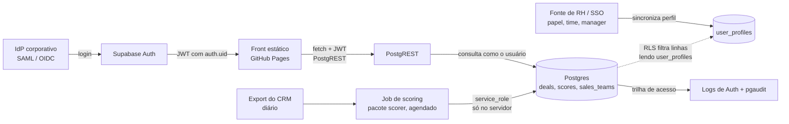

# Arquitetura de produção — Lead Scorer

Escopo: como entregar o controle de acesso "vendedor vê a própria carteira, manager vê o time, RevOps vê tudo". Contexto do modelo: [MODEL_CARD.md](MODEL_CARD.md). Contrato dos dados: `solution/app/data-contract.md`. A escolha entre as opções A e B está em [DECISIONS.md](DECISIONS.md).

## 1. Requisito de controle e por que a opção A não atende

**Requisito:** o vendedor vê só a própria carteira, o manager vê só o time, e RevOps vê tudo.

A opção A (a entrega atual) é uma página estática no GitHub Pages. O `scorer.build` grava um `data.js` único (`window.LEAD_DATA`) com **todos** os deals de **todos** os 35 vendedores, em todos os snapshots. A tela de entrada "Quem é você?" (vendedor ou manager) apenas filtra esse conjunto no navegador.

Consequência: quem abre a página, ou só baixa o `data.js`, tem o pipeline inteiro. A separação por perfil na interface é de **experiência** (mostrar menos), não de **segurança** (impedir o acesso). Filtro no cliente não é controle de acesso. Para o experimento, com dados sintéticos e públicos, isso é aceitável. Com dados reais de clientes, não é.

Para atender o requisito, o dado fora do escopo do usuário nunca pode chegar ao navegador. Isso exige autenticação e um servidor que filtre as linhas.

## 2. Arquitetura alvo (opção B)

Front estático (o mesmo HTML/CSS/JS, no GitHub Pages) + Supabase: Auth com SSO corporativo (SAML ou OIDC) e Postgres com Row-Level Security (RLS). O front consulta a API PostgREST com o JWT do usuário, e o banco devolve só as linhas permitidas.



Pontos de projeto:

- **Job de scoring no servidor.** O mesmo pacote `scorer` (`clean` -> `score` -> `explain`) roda agendado (por exemplo, diário, 06:00) em um runner fora do navegador (GitHub Actions agendado ou função agendada). Em vez de gerar `data.js`, o `build.py` grava `deals` e `scores` no banco.
- **Leitura só com o JWT do usuário.** O front usa a chave `anon` mais o JWT da sessão. A RLS decide as linhas; o front não tem lógica de permissão que valha como segurança.
- **`service_role` só no job.** Essa chave **ignora a RLS** (`BYPASSRLS`). Se ela estiver no front, ou em qualquer coisa servida ao navegador, qualquer pessoa lê tudo e a RLS não serve de nada. Ela fica como segredo do runner agendado, nunca no repositório nem no JS.
- **Backtest e "Como funciona"** são agregados sem dado de deal. Podem ficar numa tabela `model_runs` legível por qualquer usuário autenticado, ou continuar num JSON estático.

## 3. Modelo de dados (SQL DDL)

> **SQL não executado — validar.** Não há Postgres nem Docker nesta máquina. O SQL das seções 3 e 4 foi escrito, não rodado.

```sql
create type app_role as enum ('vendedor', 'manager', 'revops');

create table sales_teams (            -- cadastro (35 vendedores)
  sales_agent     text primary key,
  manager         text not null,
  regional_office text not null
);

create table deals (                  -- um registro por oportunidade
  opportunity_id text primary key,
  sales_agent    text not null references sales_teams(sales_agent),
  manager        text not null,     -- copiado do cadastro no carregamento
  account        text,              -- nulo em 1.425 deals abertos
  product        text not null,
  sales_price    numeric not null,  -- preço de tabela
  deal_stage     text not null,
  engage_date    date,              -- nulo em Prospecting
  close_date     date,
  close_value    numeric
);
create index on deals (sales_agent);
create index on deals (manager);

create table scores (                 -- saída do job, uma linha por deal por data
  opportunity_id text not null references deals(opportunity_id),
  as_of_date     date not null,
  age_days       int,
  p_win          numeric,
  expected_value numeric,
  score          int,
  category       text not null check (category in ('Foque','Reative','Limpe','Qualifique')),
  why            text[] not null,
  primary key (opportunity_id, as_of_date)
);

create table user_profiles (
  user_id     uuid primary key references auth.users(id) on delete cascade,
  role        app_role not null,
  sales_agent text,                 -- obrigatório se vendedor
  manager     text,                 -- obrigatório se manager
  check (role <> 'vendedor' or sales_agent is not null),
  check (role <> 'manager'  or manager is not null)
);
```

## 4. Políticas RLS

> **SQL não executado — validar.** As funções `security definer` leem `user_profiles` sem depender da RLS dela própria e evitam recursão de política.

```sql
create schema if not exists private;

create or replace function private.my_profile()
returns table (role app_role, sales_agent text, manager text)
language sql stable security definer set search_path = ''
as $$
  select p.role, p.sales_agent, p.manager
  from public.user_profiles p
  where p.user_id = auth.uid();
$$;
revoke all on function private.my_profile() from public, anon;
grant execute on function private.my_profile() to authenticated;
grant usage on schema private to authenticated;

alter table deals          enable row level security;
alter table scores         enable row level security;
alter table sales_teams    enable row level security;
alter table user_profiles  enable row level security;
revoke all on deals, scores, sales_teams, user_profiles from anon;

-- deals: vendedor = a própria carteira; manager = o time; revops = tudo
create policy deals_select on deals for select to authenticated using (
  exists (
    select 1 from private.my_profile() me
    where me.role = 'revops'
       or (me.role = 'manager'  and deals.manager     = me.manager)
       or (me.role = 'vendedor' and deals.sales_agent = me.sales_agent)
  )
);

-- scores: herda o escopo do deal (a subconsulta em deals já passa pela RLS)
create policy scores_select on scores for select to authenticated using (
  exists (select 1 from deals d where d.opportunity_id = scores.opportunity_id)
);

-- cadastro: manager e vendedor veem só o próprio time; revops vê tudo
create policy teams_select on sales_teams for select to authenticated using (
  exists (
    select 1 from private.my_profile() me
    where me.role = 'revops'
       or (me.role = 'manager'  and sales_teams.manager = me.manager)
       or (me.role = 'vendedor' and sales_teams.manager =
             (select t.manager from public.sales_teams t where t.sales_agent = me.sales_agent))
  )
);

-- perfil: cada um lê o próprio; ninguém escreve pelo front
create policy profile_self on user_profiles for select to authenticated
  using (user_id = auth.uid());
-- Sem policies de insert/update/delete: só o service_role (sincronização de RH) grava.
```

Sem perfil, `my_profile()` devolve zero linhas, o `exists` é falso e nada é lido (negar por padrão). Não há política de escrita em `deals` e `scores`; só o job, com `service_role`, grava.

**Casos de teste a rodar** (com `set local role authenticated; set local request.jwt.claims = '{"sub":"<uuid>"}'` e dados de demonstração):

| # | Caso | Esperado |
|---|---|---|
| 1 | Vendedor A consulta o deal do vendedor B (mesmo time ou outro) | 0 linhas |
| 2 | Vendedor A consulta `deals` e `scores` sem filtro | só os deals dele, e `scores` na mesma contagem |
| 3 | Manager consulta `deals` | só os deals dos vendedores do time dele; 0 de outro time |
| 4 | RevOps consulta `deals` e `scores` | contagem igual à tabela inteira |
| 5 | Usuário autenticado sem linha em `user_profiles` | 0 linhas em `deals`, `scores` e `sales_teams` |
| 6 | `anon` (sem login) consulta qualquer tabela | erro de permissão |
| 7 | Vendedor tenta `insert`/`update` em `deals` ou `user_profiles` | negado |
| 8 | Troca o `manager` do perfil e repete o caso 3 | resultado muda na consulta seguinte |

## 5. Governança

- **Trilha de auditoria de acesso.** Logs de Auth (logins, falhas, refresh) e a extensão `pgaudit` (`pgaudit.log = 'read'` nas tabelas `deals` e `scores`) mostram quem leu o quê. Alternativa mais leve: uma tabela `access_log` alimentada por uma RPC que o front chama ao abrir a tela. Retenção mínima de 12 meses; leitura só por RevOps.
- **Minimização de dados (LGPD).** O banco guarda só os campos que o score e a tela usam: conta, produto, preço, datas, estágio. **Sem nome, e-mail ou telefone de contato** do cliente. Colunas novas passam por revisão de RevOps. `close_value` e `why` ficam porque a tela os mostra. Dados de deals encerrados há mais de 24 meses podem ser removidos ou anonimizados.
- **Revisão periódica de acessos.** Trimestral, pelo dono (RevOps), junto com a recalibração do modelo ([MODEL_CARD.md](MODEL_CARD.md), seções 7 e 9): listar `user_profiles` por papel, remover quem saiu, conferir que há poucos `revops` e que todo `manager` aponta para um time existente.
- **Mudança de time.** A fonte de RH (ou o SSO, via grupo/claim mapeado) atualiza `user_profiles` (`sales_agent`, `manager`). O acesso muda **na hora**, porque a RLS lê o perfil a cada consulta e não guarda papel ou time no JWT. A decisão de ler o perfil, em vez de colocar o papel no token, evita que um token antigo preserve acesso depois da mudança. O histórico dos deals continua com o `manager` gravado no `deals`; se a regra for "o manager novo vê os deals antigos do vendedor", o job de carga atualiza `deals.manager` a partir do cadastro.
- **O vendedor continua fora do score (decisão 4).** O controle de acesso não muda o cálculo. Quem vê o quê é um filtro de leitura; o score não usa o vendedor, e a tela não mostra taxa de vitória por vendedor. A permutação de vendedores (`test_permuting_sales_agent_changes_no_score`) segue valendo para o job de produção.

## 6. Caminho de migração de A para B

| Etapa | O que fazer | Horas |
|---|---|---:|
| 1 | Criar o projeto Supabase (dev e prod), região, segredos do runner, política de chaves (`service_role` só no job) | 3 |
| 2 | Configurar SSO (SAML/OIDC) com o IdP e mapear grupos para papéis | 6 |
| 3 | Migrar o schema (seção 3) e as políticas RLS (seção 4); rodar os 8 casos de teste e corrigir | 10 |
| 4 | Adaptar o `build.py`: manter o scoring e trocar `write_data_js` por upsert em `deals` e `scores` (idempotente, por `as_of_date`); agendar o job | 12 |
| 5 | Trocar o `data.js` por `fetch` autenticado no front (login, sessão, consulta já filtrada pela RLS, estados de carga e erro, reaproveitando o contrato como formato de resposta) | 14 |
| 6 | Contas de demonstração (1 vendedor por time, 1 manager, 1 RevOps, 1 sem perfil) e verificação ponta a ponta no navegador | 6 |
| 7 | Auditoria (`pgaudit` ou `access_log`), rotina de revisão trimestral, documentação operacional | 5 |
| | **Total estimado** | **56** |

Os dados de demonstração continuam sintéticos. A produção só entra depois do aval de segurança e da Head de RevOps, e o `data.js` público é desligado na virada.

---

A decisão A versus B está registrada em [DECISIONS.md](DECISIONS.md).

*Redigido por Claude Sonnet (subagente executor), a pedido do Rafael.*
